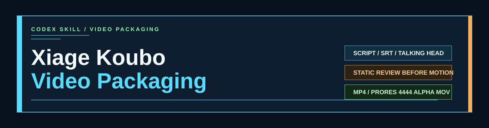
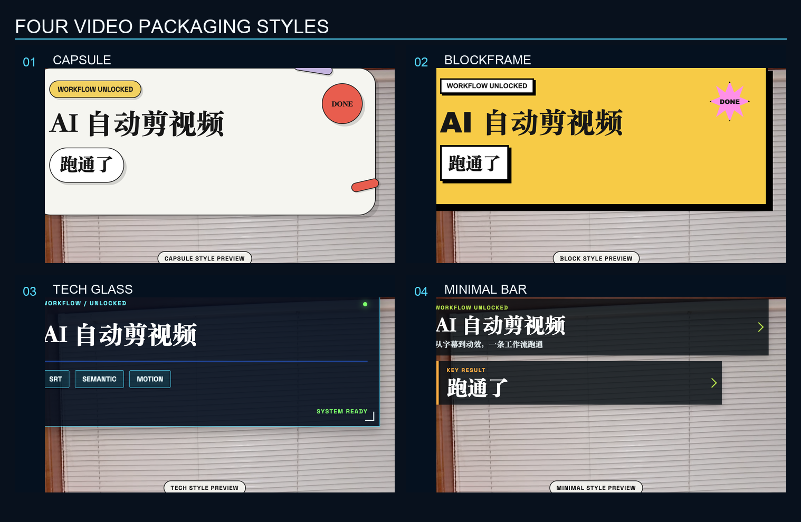
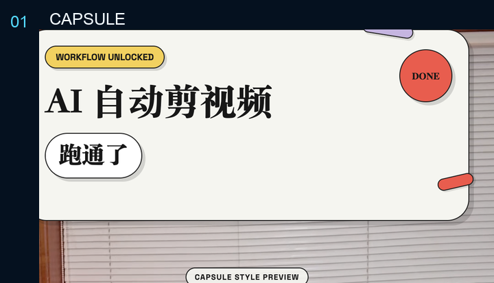
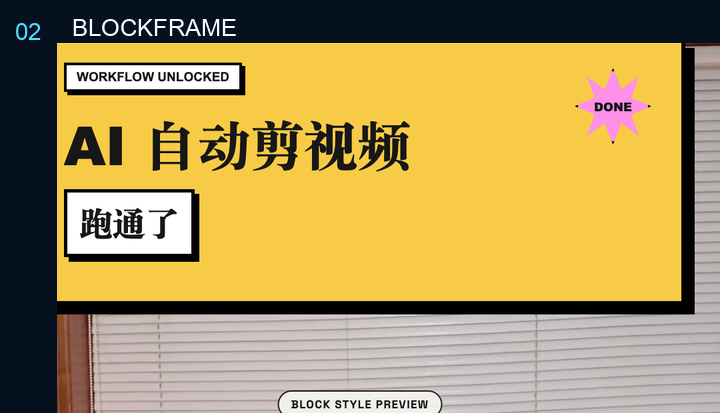
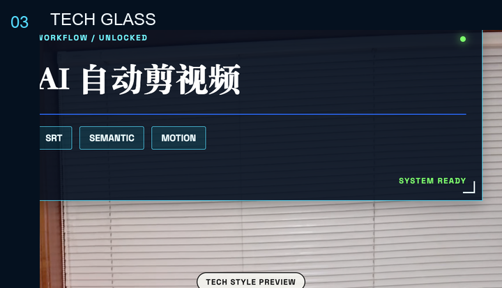
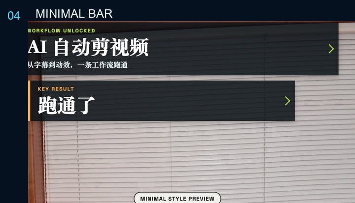
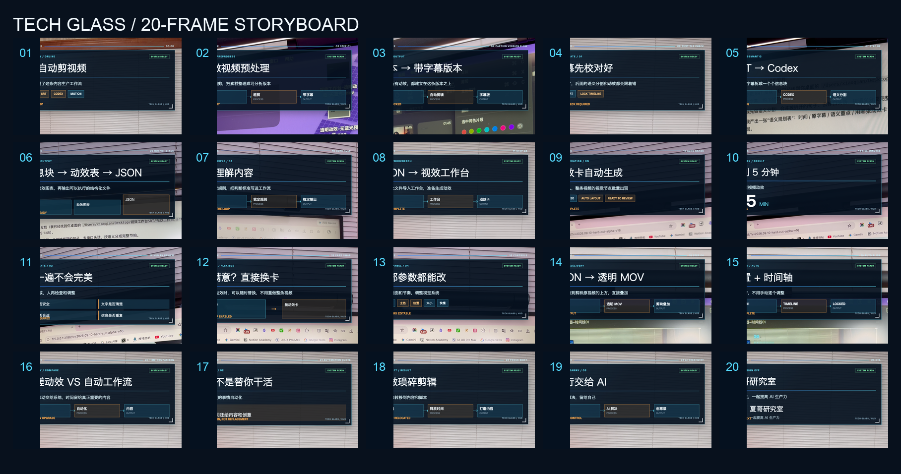

# Xiage Koubo Video Packaging

[English](README.md) | [简体中文](README.zh-CN.md)



A Codex skill that turns Chinese scripts, SRT subtitles, and talking-head videos into reviewable video packaging systems.

It helps Codex do more than generate a few decorative cards. The skill defines a repeatable production loop: understand the source, segment the content, choose a visual language, produce static frames for review, then turn the approved direction into HyperFrames animation or a transparent overlay.

## Why This Skill

Most video motion work fails in one of two places:

- The animation starts before the on-screen copy and sequence are approved.
- The graphics are visually strong but cover the presenter, the existing subtitles, or the meaning of the shot.

This skill puts the review gate before production and keeps the presenter at the center of the layout.

## Four Visual Styles



| Style | Character | Best for |
| --- | --- | --- |
| `1` Capsule 胶囊风 | Cream paper, rounded capsules, candy colors, editorial display type | Creator education, AI tools, personal workflows |
| `2` BlockFrame 新粗野主义 | Thick black borders, hard shadows, saturated poster blocks | Strong opinions, hot topics, high-energy listicles |
| `3` Tech Glass / Workflow HUD | Dark glass panels, process nodes, cyan and orange signals | AI agents, automation, software, product demos |
| `4` Minimal Bar 信息条风 | Restrained translucent bars and compact labels | Talking-head tutorials and interviews where the person stays dominant |

### Capsule



### BlockFrame



### Tech Glass



### Minimal Bar



## Workflow

```text
Script / SRT / video
        |
        v
Inspect orientation, duration, subtitles, and face boundary
        |
        v
Choose one of four visual styles
        |
        v
Semantic segmentation and motion table
        |
        v
About 20 static frames for review
        |
        v
User approves or requests revisions
        |
        v
HyperFrames animation or transparent MOV overlay
```

The skill does not silently choose a style. If a new task does not specify one, it presents the four options and waits.

## Example Storyboard

The static review phase can produce a full visual sequence before any MOV is rendered.



## What It Produces

- A semantic motion table with time ranges, overlay copy, motion form, position, and strength.
- A set of still frames sized for the target platform.
- A contact sheet for fast review.
- HyperFrames animated `MP4` output for script-led videos.
- A transparent `ProRes 4444` MOV for placement above an existing talking-head edit.
- Alpha, layout, face-safety, and subtitle-safety checks before delivery.

## Install

Clone the repository and copy the skill folder into your Codex skills directory:

```bash
git clone https://github.com/yuema4/xiage-koubo-video-packaging.git
mkdir -p ~/.codex/skills
cp -R xiage-koubo-video-packaging ~/.codex/skills/
```

The skill is loaded from:

```text
~/.codex/skills/xiage-koubo-video-packaging/SKILL.md
```

## Use It in Codex

Start with a script or a talking-head video. If the style is not specified, the skill asks you to choose one.

Chinese example:

```text
用 xiage-koubo-video-packaging，
把这段脚本做成竖屏口播视频包装。
先让我选风格，再做语义分割、动效表和 20 张静态预览。
我审核后再生成透明底 MOV。
```

English example:

```text
Use xiage-koubo-video-packaging.
Turn this script into a portrait video package.
Let me choose the style first, then create the semantic motion table
and about 20 static previews. Render the alpha MOV only after approval.
```

## Repository Structure

```text
xiage-koubo-video-packaging/
|-- SKILL.md
|-- README.md
|-- README.zh-CN.md
|-- LICENSE
|-- agents/
|   `-- openai.yaml
|-- assets/
|   |-- banner.svg
|   |-- style-overview.png
|   |-- style-capsule.png
|   |-- style-blockframe.png
|   |-- style-tech-glass.png
|   |-- style-minimal-bar.png
|   `-- tech-glass-storyboard.png
|-- references/
|   `-- style-options.md
`-- scripts/
    `-- build_readme_assets.py
```

## Requirements

- Codex with local skill support.
- HyperFrames for animated video output.
- FFmpeg with ProRes support for transparent MOV delivery.
- A source video and SRT when overlaying an existing talking-head edit.

## Scope

This skill focuses on Chinese talking-head and creator-education videos. It is especially useful for Xiaohongshu, WeChat Channels, Bilibili, YouTube tutorials, AI workflow videos, and product explainers.

## License

[MIT](LICENSE)
