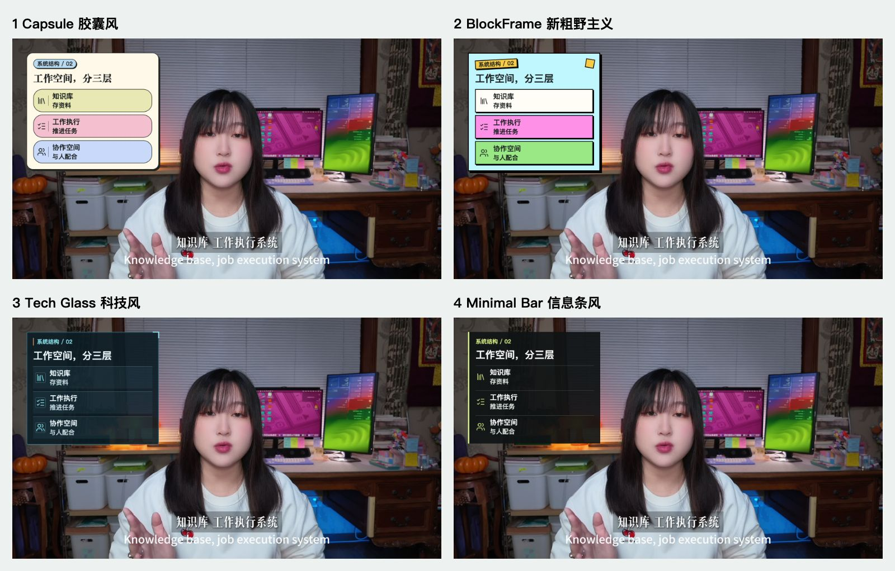

# 夏哥口播视频包装

[English](README.md) | [简体中文](README.zh-CN.md)


一个 Codex Skill，把中文脚本、SRT 字幕和真人口播视频，转化成可审核、可执行、可动画化的视频包装系统。

它不只是让 AI 生成几张装饰卡片，而是把整条生产流程固定下来：看懂素材、做语义分割、选择视觉风格、生成静态预览、等待审核，最后再输出 HyperFrames 动画或透明底叠加视频。

## 为什么需要它

视频动效最容易出问题的两个地方：

- 文案和顺序还没确认，就开始做动画，返工成本很高。
- 画面很炫，但遮住了人物、字幕，或者没有表达清楚重点。

这个 Skill 把审核提前到动画制作之前，并且始终以真人为画面主体，动效只负责补充信息。

## 四种视频包装风格


| 风格 | 视觉特点 | 适合内容 |
| --- | --- | --- |
| `1` Capsule 胶囊风 | 奶油纸背景、圆润胶囊卡片、糖果色、编辑感大字 | AI 工具、自媒体教程、个人工作流 |
| `2` BlockFrame 新粗野主义 | 粗黑边框、硬阴影、高饱和色块、海报感 | 强观点、热点、清单、高节奏内容 |
| `3` Tech Glass / Workflow HUD | 深色玻璃、流程节点、青蓝与橙色状态 | AI Agent、自动化、软件功能、产品演示 |
| `4` Minimal Bar 信息条风 | 克制的半透明横条、少装饰、信息清楚 | 口播教程、访谈、需要突出人物主体的视频 |

### Capsule 胶囊风


### BlockFrame 新粗野主义


### Tech Glass 科技风


### Minimal Bar 信息条风


## 工作流

```text
脚本 / SRT / 口播视频
        |
        v
检查横竖屏、时长、字幕和人物安全区
        |
        v
从四种风格中选择一种
        |
        v
语义分割，生成动效表
        |
        v
按时长生成静态预览（每分钟约15组）
        |
        v
用户审核文字、顺序和画面
        |
        v
HyperFrames 动画或透明底 MOV
```

新任务没有指定风格时，Skill 不会默认替你选择，而是先给出四种风格。

## 横屏适配与图标版工作流

横屏口播默认把卡片放在**左上方**，根据真实人物、手势、字幕和演示内容确定安全区。横屏会重新排版，不直接缩小竖屏卡。

- 每分钟约15组独立动效，其中重点PPT卡至少为`ceil(时长秒数/30)`组，计入总数。
- 工具配核实的Logo，动作配语义图标，关系用流程或对比图；通用图标不能冒充官方Logo。
- 要比较风格时，选相同4段内容，每种风格各4张，共**16张实拍合成图**，文案和原截图保持一致。
- 先审核动效表与静态图，再制作动画，最终检查透明通道并交付桌面，保留旧版。



[查看全部16张横屏示例与卡片特写](assets/landscape/README.md) · [完整中英文工作流](references/landscape-workflow.md)

```text
用夏哥口播Skill处理这条横屏视频和SRT，卡片放在左上方，避开人物和字幕。
先选4段内容，四种风格每种各做4张，让我比较。
选好风格后，按时长制作完整动效表与静态预览，
加入语义图标、相关工具Logo和重点PPT卡。
等我确认后再输出透明底MOV，保存到桌面。
```

## 预览示例

静态审核阶段可以先看到完整视觉序列，确认后再生成 MOV。


## 你会得到什么

- 一份动效表：时间、原字幕、动效文案、动效形式、位置、强度。
- 一组按目标平台尺寸生成的静态预览图。
- 一张方便快速审核的总览 contact sheet。
- 脚本类视频的 HyperFrames 动画 `MP4`。
- 口播视频的透明底 `ProRes 4444` MOV。
- 交付前的透明通道、画面边界、人物安全区和字幕安全区检查。

## 安装

克隆仓库，把 Skill 文件夹复制到 Codex 的 Skill 目录：

```bash
git clone https://github.com/yuema4/xiage-koubo-video-packaging.git
mkdir -p ~/.codex/skills
cp -R xiage-koubo-video-packaging ~/.codex/skills/
```

加载位置：

```text
~/.codex/skills/xiage-koubo-video-packaging/SKILL.md
```

## 在 Codex 里怎么用

直接给它一段脚本，或者一条口播视频加 SRT。没有指定风格时，它会先让你选择。

中文示例：

```text
用 xiage-koubo-video-packaging，
把这段脚本做成竖屏口播视频包装。
先让我选风格，再按时长做语义分割、动效表和静态预览。
我审核后再生成透明底 MOV。
```

英文示例：

```text
Use xiage-koubo-video-packaging.
Turn this script into a portrait video package.
Let me choose the style first, then create the semantic motion table
and duration-based static previews. Render the alpha MOV only after approval.
```

## 仓库结构

```text
xiage-koubo-video-packaging/
|-- SKILL.md
|-- README.md
|-- README.zh-CN.md
|-- LICENSE
|-- agents/
|   `-- openai.yaml
|-- assets/
|   |-- banner.svg
|   |-- style-overview.png
|   |-- style-capsule.png
|   |-- style-blockframe.png
|   |-- style-tech-glass.png
|   |-- style-minimal-bar.png
|   `-- tech-glass-storyboard.png
|-- references/
|   `-- style-options.md
`-- scripts/
    `-- build_readme_assets.py
```

## 使用条件

- Codex 支持本地 Skill。
- 生成动画视频时使用 HyperFrames。
- 导出透明 MOV 时需要支持 ProRes 的 FFmpeg。
- 给已有口播视频叠加动效时，需要原视频和 SRT。

## 适用范围

主要面向中文口播视频、知识教程和创作者内容，尤其适合小红书、视频号、B站、YouTube 教程、AI 工作流和产品讲解视频。

## 许可证

Skill代码与文档采用[MIT](LICENSE)。出镜示例图与第三方图标说明见[素材说明](assets/landscape/README.md#asset-notes--素材说明)。
