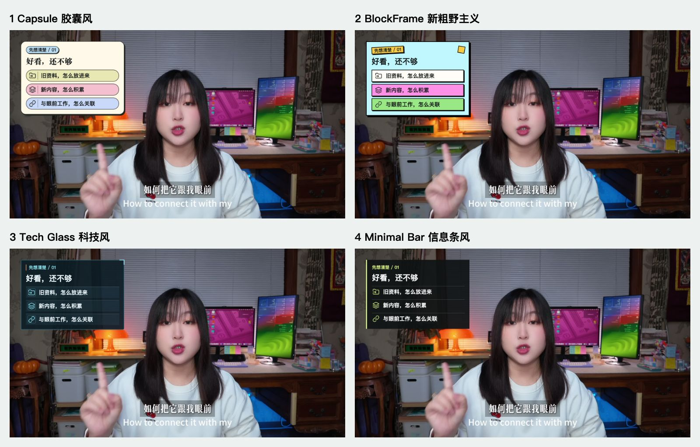
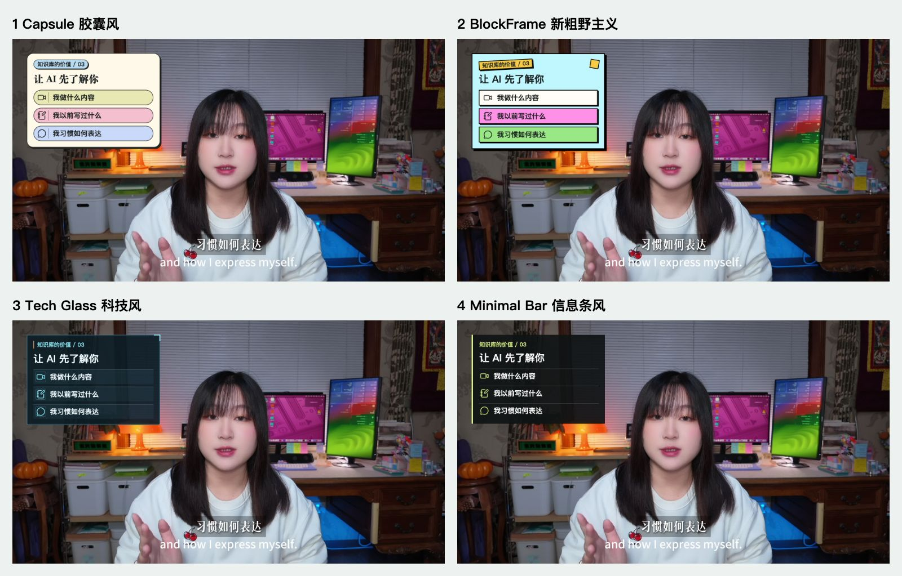
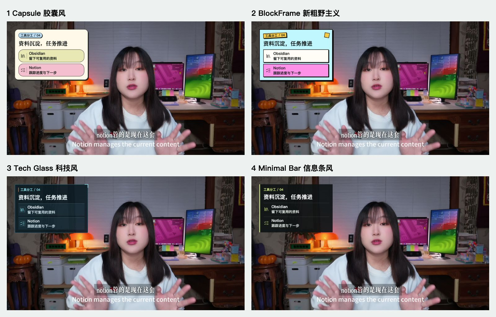

# Landscape Examples / 横屏风格示例

Four excerpts from the same talking-head video, each in four styles: **16 static composites**. Same copy, semantic icons, source frame, and upper-left anchor for each comparison. These are not animated exports.

同一条口播视频的4段内容，各做4种风格，共16张静态合成图。相同内容使用同一原截图、文案、语义图标和左上定位，便于公平比较。

## 01 · 好看，还不够 / More Than Appearance

| Style / 风格 | Full frame / 实拍图 | Card / 特写 |
|---|---|---|
| Capsule | [View](capsule-01-preview.jpg) | [Detail](capsule-01-detail.jpg) |
| BlockFrame | [View](block-01-preview.jpg) | [Detail](block-01-detail.jpg) |
| Tech Glass | [View](tech-01-preview.jpg) | [Detail](tech-01-detail.jpg) |
| Minimal Bar | [View](minimal-01-preview.jpg) | [Detail](minimal-01-detail.jpg) |

## 02 · 工作空间分三层 / Three Workspace Layers

| Style / 风格 | Full frame / 实拍图 | Card / 特写 |
|---|---|---|
| Capsule | [View](capsule-02-preview.jpg) | [Detail](capsule-02-detail.jpg) |
| BlockFrame | [View](block-02-preview.jpg) | [Detail](block-02-detail.jpg) |
| Tech Glass | [View](tech-02-preview.jpg) | [Detail](tech-02-detail.jpg) |
| Minimal Bar | [View](minimal-02-preview.jpg) | [Detail](minimal-02-detail.jpg) |

## 03 · 让AI先了解你 / Give AI Your Context

| Style / 风格 | Full frame / 实拍图 | Card / 特写 |
|---|---|---|
| Capsule | [View](capsule-03-preview.jpg) | [Detail](capsule-03-detail.jpg) |
| BlockFrame | [View](block-03-preview.jpg) | [Detail](block-03-detail.jpg) |
| Tech Glass | [View](tech-03-preview.jpg) | [Detail](tech-03-detail.jpg) |
| Minimal Bar | [View](minimal-03-preview.jpg) | [Detail](minimal-03-detail.jpg) |

## 04 · 资料沉淀与任务推进 / Knowledge and Execution

| Style / 风格 | Full frame / 实拍图 | Card / 特写 |
|---|---|---|
| Capsule | [View](capsule-04-preview.jpg) | [Detail](capsule-04-detail.jpg) |
| BlockFrame | [View](block-04-preview.jpg) | [Detail](block-04-detail.jpg) |
| Tech Glass | [View](tech-04-preview.jpg) | [Detail](tech-04-detail.jpg) |
| Minimal Bar | [View](minimal-04-preview.jpg) | [Detail](minimal-04-detail.jpg) |

## Asset Notes / 素材说明

- Creator: 夏哥研究室 / 李棂夏. Publication of these composites, including the creator's likeness, was expressly authorized on 2026-10-26. This publication does not imply endorsement or permission to impersonate the creator. The repository's code license does not grant likeness rights.
- 创作者已授权发布这些含本人出镜的示例。此授权不意味着允许冒用身份或声称获得创作者背书；代码许可证不授予肖像权。
- Full-frame previews preserve 1920x1080 dimensions and are JPEG derivatives of the approved PNGs. No raw footage, full transcript, or MOV is included.
- 图标来自Lucide，见[附带许可证](Lucide-LICENSE.txt)。Obsidian/Notion图示为通用图标，不是官方Logo。
- Lucide icons are covered by the [included license](Lucide-LICENSE.txt). Tool labels use generic icons, not official Obsidian or Notion brand marks.
- The 592px-wide card at (64,64) is an example, not a universal safe zone. Inspect each video's people, gestures, subtitles, and demonstrations.

[Workflow / 工作流](../../references/landscape-workflow.md) · [English README](../../README.md) · [中文说明](../../README.zh-CN.md)
